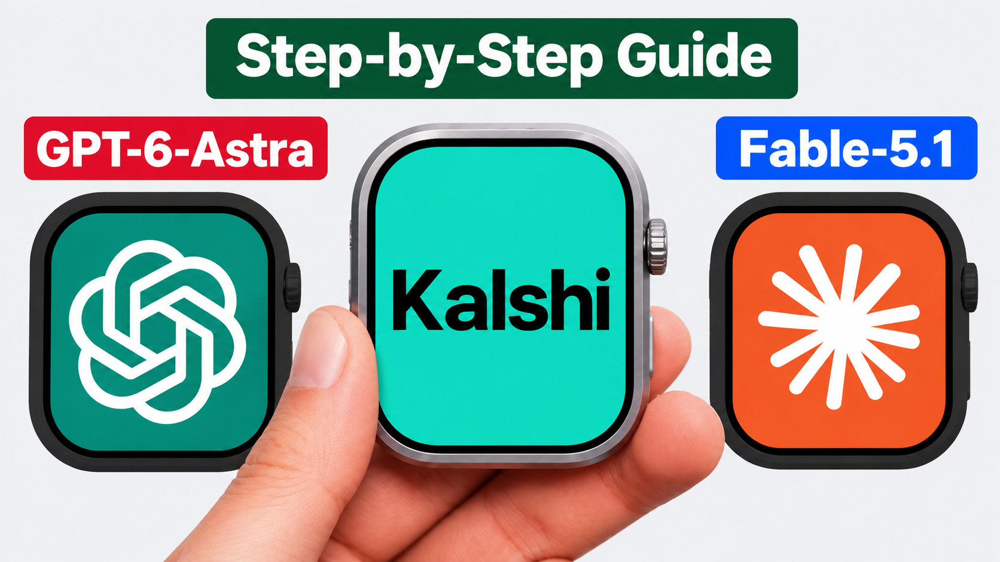

import CodeBlock from '@theme/CodeBlock';
import CredentialCopyList from '@site/src/components/CredentialCopyList';
import paperTradingCode from './Ai-Paper-script.ahk?raw';
import liveTradingCode from './Ai-Live-script.ahk?raw';

# Kalshi AI trading bot

This guide shows how to use Nightshark's AI Mode to analyze Kalshi's 15-minute crypto markets and turn each model response into a paper or live trade. Choose the AI model, cost, and instructions in AI Mode, then use the script settings below to control the assets, order size, decision timing, and daily limits.

:::tip Latest Nightshark Version Required
This guide uses Nightshark's AI Mode and requires the latest Nightshark build.

<a className="btn-nightshark-small" href="https://nightshark.io" target="_blank" rel="noopener noreferrer">
  Download Latest Nightshark
</a>
:::

## How the bot works

The bot requests one AI decision for each 15-minute market when the configured `timeDelay` is reached. The model returns **UP**, **DOWN**, or **SKIP**. The decision is cached for that market, and an UP or DOWN position is held through resolution.

The main strategy settings are shared by both scripts:

- `assets` selects one or more supported markets: BTC, ETH, SOL, XRP, DOGE, HYPE, or BNB.
- `orderSize` sets the simulated paper size or the number of live contracts.
- `timeDelay` controls when the AI request is made, from 15 minutes remaining down to just before the market closes.
- `Obey_model` uses the model's direction when set to `YES` and trades the opposite direction when set to `NO`.
- `Max_daily_profit` and `Max_daily_Loss` stop new trading after settled strategy PnL reaches either limit. Use `0` to disable a limit.

Configure the model, cost, and instructions in AI Mode before pressing **Run**. Start with paper trading so you can review the model's decisions and the bot's behavior without submitting live orders.

## Paper-Trading Code

Paper mode reads live market data and simulates entries without placing real Kalshi orders. Paste the complete script into Nightshark's Code editor.

<CodeBlock language="javascript">
  {paperTradingCode}
</CodeBlock>

## Live-Trading Setup

Live mode submits real Kalshi orders. Add your Kalshi API key and private key to Nightshark using these filenames, matching the credential fields used in Video 14:

<CredentialCopyList
  items={[
    {label: 'API Key', value: 'apikey'},
    {label: 'Private Key', value: 'privatekey'}
  ]}
/>

:::warning Use paper mode first
Live trading uses real funds. Confirm your AI instructions, selected model, asset list, order size, timing, and daily limits in paper mode before running the live script.
:::

## Live-Trading Code

Paste the complete script into Nightshark's Code editor after the credential files are configured.

<CodeBlock language="javascript">
  {liveTradingCode}
</CodeBlock>
